# Brick Kiln ERP — case study

A mobile-first, Bangla-language ERP that runs the day-to-day accounts of a traditional handmade-brick kiln (ইটভাটা) in Bangladesh. I designed, built and deployed it on my own, and it is used daily by the kiln's managers and owner.

> This repository is a **public case study**. The production code and all business data stay private. It explains the problem, the design and the decisions behind it.

**Stack:** Next.js 15 (App Router, server actions) · TypeScript · PostgreSQL (Neon) · Drizzle ORM · Tailwind CSS · Claude vision API · Vercel

---

## The problem

A brick kiln runs a season of several months with dozens of workers, several contractor teams and a steady stream of buyers. Before this app, everything lived in paper notebooks and handwritten slips:

- Cash came in and went out through several people's hands, and nobody could say at any moment how much cash each person was holding.
- Contractor teams (moulders, firemen, loaders) take **advances (dadon)** before the season and are paid by output, so their balances are hard to track by hand.
- Buyers often pay part now and the rest later. Dues were easy to lose.
- Handwritten slips had arithmetic mistakes that nobody re-checked.
- The owner could not see the business without being on site.

## What I built

| Area | What it does |
|---|---|
| **Dashboard** | Cash in hand, money from sales, total cost, customer dues, contractor advances outstanding, approximate profit, bricks moulded and sold |
| **Cash book** | Every taka in and out with a running balance; expenses, labour, advances and sales flow in automatically |
| **Who holds the money** | Each entry's money is held by whoever wrote it, split into cash / bKash / bank. Managers hand money to the owner from the app; the total never changes, only whose hand it is in |
| **Expenses** | Fuel, coal, wood, food and so on, with owner-managed categories |
| **Daily labour** | Manager enters only the head count; amount = count × the owner's rate |
| **Contractor ledger** | Work done (per 1,000 bricks or per day), advances, wages, deductions and bonuses; balance shows "contractor is owed" or "advance outstanding" |
| **Sales & dues** | Sales by brick class, part payments and a customer dues ledger that carries over between seasons |
| **AI slip scan** | Photo of a handwritten slip → AI reads each line → **the app re-checks every quantity × rate and the slip total** → Bangla summary and warnings → manager confirms → saved, with the photo kept for audit |
| **Live updates** | Others see "Rahim is entering an expense •••" while someone types; lists refresh when anyone saves |
| **Reports** | Any date range: in/out summary, expenses by category, day-by-day cash, contractor summary; PDF and print |
| **Installable** | Works as an app from the phone's home screen, with an offline page |

## Architecture

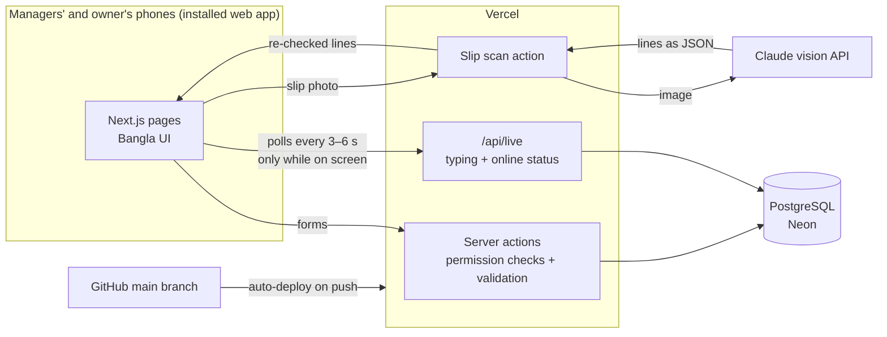

## Data model

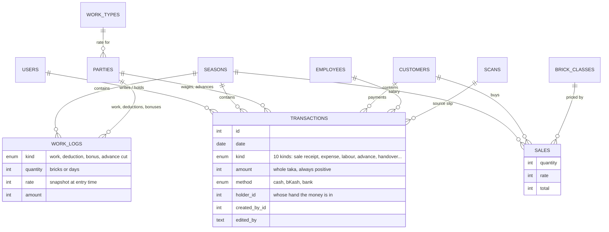

## Design decisions

1. **Money is whole taka, stored as integers.** No floating-point rounding errors in balances.
2. **Every entry keeps a snapshot of the rate used.** When the owner changes a rate, old entries do not change; only new ones use the new rate.
3. **One transaction table, direction set by kind.** Amounts are always positive and the kind decides whether money goes in or out, so every report sums one table the same way.
4. **Permissions are enforced on the server, not just hidden in the UI.** Managers can edit only their own entries and only on the same day (Bangladesh time); the next day the entry is locked. Managers cannot change rates. Salary entries are owner-only.
5. **Every change is traceable.** Each row records who created it and who last edited it, and when.
6. **AI output is never trusted on its own.** The model only reads the slip. The app itself recomputes every line and the total, flags any mismatch in Bangla, and a person confirms before anything is saved.
7. **Seasons separate the books.** Cash and contractor accounts reset each season, while customer dues carry over.
8. **Cheap to run.** Live updates use short polling only while the page is visible, so the app stays within free-tier hosting and database limits.

## My role

Sole developer: requirements gathering with the owner and managers, database design, all front-end and back-end code, AI integration, deployment and ongoing support.

## What I learned

- Requirements come from how people actually work: features like "who holds the money" and same-day entry locks came from the kiln's real cash flow, not a textbook spec.
- In a business app, trust matters as much as features: locked entries, an edit trail and re-checked AI output are what let the owner rely on the numbers.
- Building for phones and Bangla text shaped the UI: large touch targets, short forms and numbers formatted the way managers write them.

## Screenshots

All screens use **demo data**: the names, amounts and slips are samples, not the kiln's real records. The interface is in Bangla because that is what the managers use.

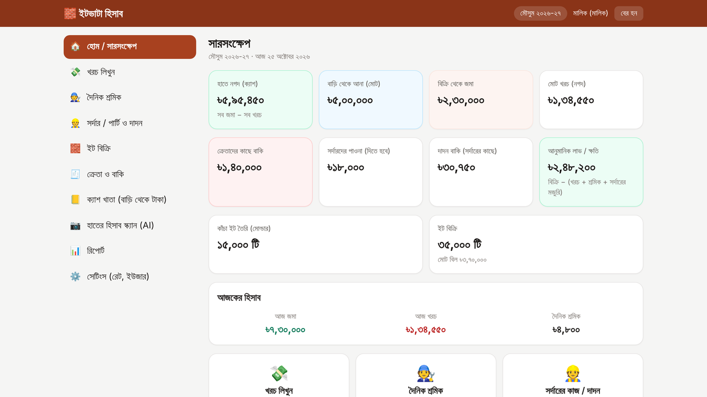

### Key screens explained in English

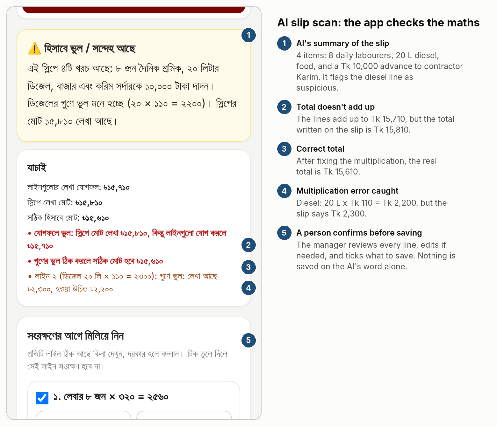

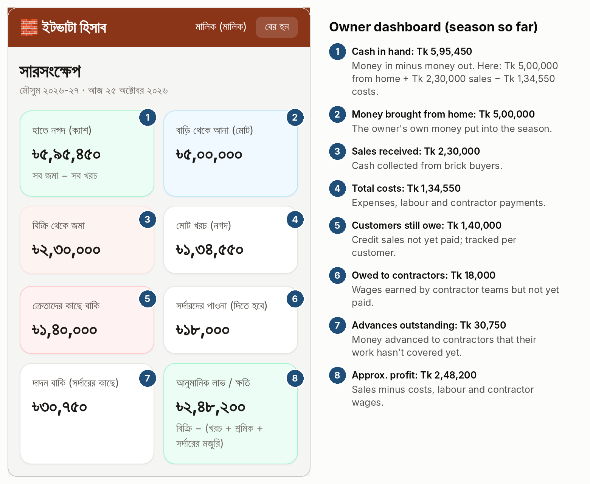

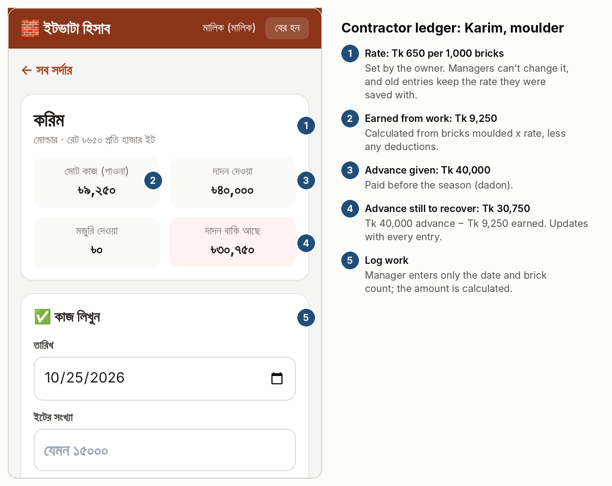

### More screens

<table>
<tr>
<td align="center" width="25%">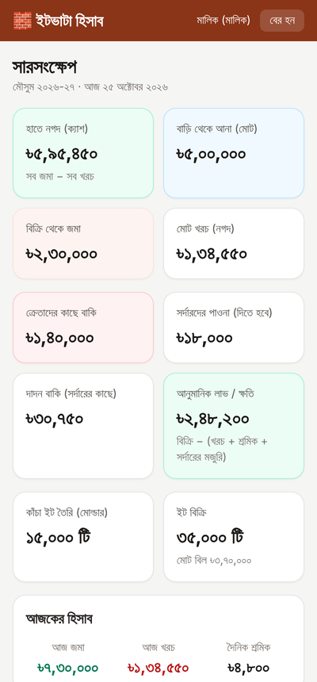 <b>Dashboard</b> cash in hand, dues, advances, profit</td>
<td align="center" width="25%">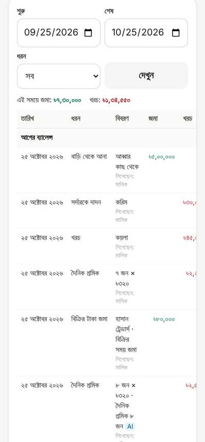 <b>Cash book</b> every taka in and out, who wrote it</td>
<td align="center" width="25%">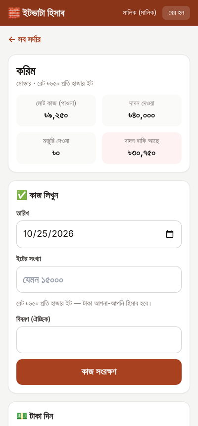 <b>Contractor ledger</b> work done, advance, balance</td>
<td align="center" width="25%">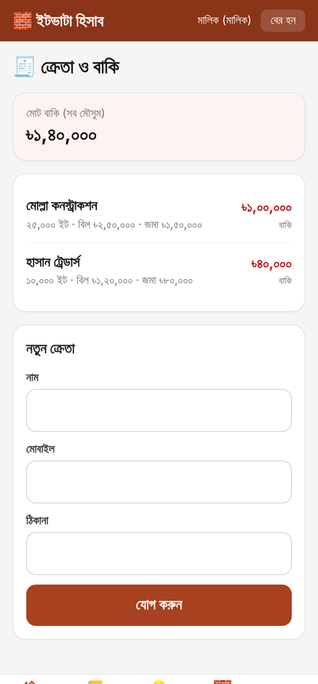 <b>Customer dues</b> who still owes, across seasons</td>
</tr>
<tr>
<td align="center">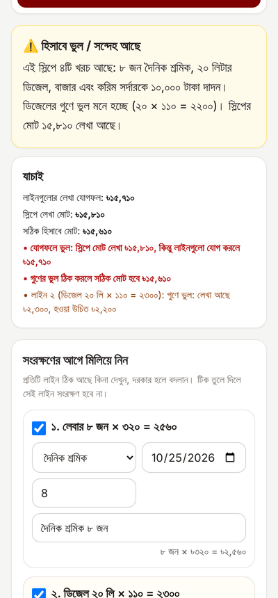 <b>AI slip scan</b> the app catches a multiplication error and a wrong total before saving</td>
<td align="center">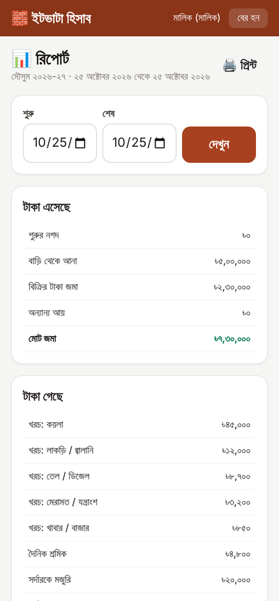 <b>Reports</b> any date range, printable</td>
<td align="center">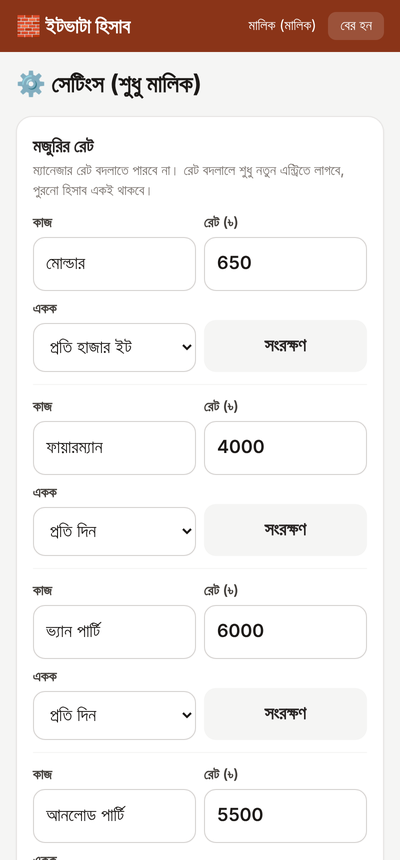 <b>Owner-only settings</b> rates, brick prices, users, seasons</td>
<td align="center">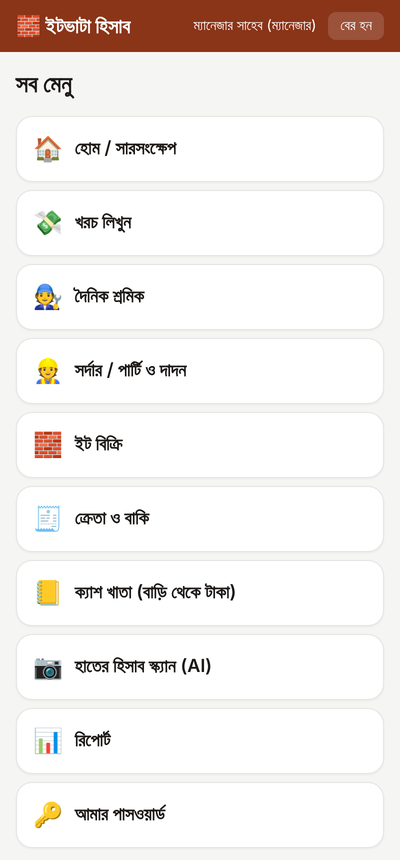 <b>Manager view</b> same app, no settings or rate changes</td>
</tr>
</table>

Full-length versions of every screen are in [`screenshots/full/`](screenshots/full).

---

**Md Jubair Imtiaj** · CSE (Information Systems), AIUB · [LinkedIn](https://www.linkedin.com/in/jubair-imtiaj-70b910451) · [GitHub](https://github.com/jubair360)
